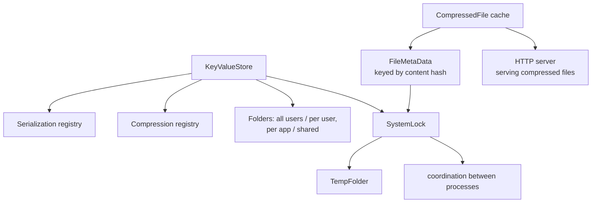

# SysWeaver.Storage

[⬆ SysWeaver overview](../README.md)

> Local persistence primitives: a redundant file-based key/value store, cached compressed copies of files, file meta-data databases, temporary cache folders and machine-wide locks.

| | |
|---|---|
| **Layer** | Storage |
| **Kind** | Library |

## Purpose

Most services need a little durable state (settings, caches, small records) without running a database. This project provides it on top of the file system, using the framework's serializers and compressors, and with redundancy and checksums so a single corrupted file does not lose data.

## How it fits into SysWeaver



## Key concepts

| Concept | Description |
|---|---|
| **Key/value store** (`KeyValueStore`) | Values are serialized, compressed (Brotli by default), suffixed with a SHA256 checksum and written as several redundant copies (at least 2, default 3), optionally spread over multiple volumes. Reads return the most recent valid copy; corrupt copies are deleted. Each key is protected by a `SystemLock`. Four static stores exist (`AllApp`, `UserApp`, `AllShared`, `UserShared`); custom stores are created with `KeyValueStore.Get(KeyValueStoreParams)` and cached by id. |
| **Compressed file cache** (`CompressedFile`) | Opens / reads a compressed version of a file and caches it on disc keyed by the file's content hash, compression type and level, so frequently served files are compressed once. |
| **File meta data** (`FileMetaData`, `FileMetaDataDb<T>`, `FileMetaDataDbAsync<T>`) | Associates derived data (json, gzip compressed) and derived files with a file's content hash and rebuilds it when the content changes; unused entries are pruned at process exit. |
| **Decompressed file hash** (`DecompressedFileHash`) | Cached MD5-based hash of the *decompressed* content of a compressed file. |
| **Compressed chunked stream** (`CompressedChunkedStream`) | A read-only stream that concatenates the decompressed content of several compressed chunks. |
| **Embedded resources** (`StorageTypeExt`) | `Type.GetManifestResourceStream/Data/Text/Object` helpers that transparently decompress resources stored compressed (ex: `MyText.txt.br`). |
| **System lock** (`SystemLock`) | A named lock visible to all processes on the machine, implemented with exclusively opened lock files (delete on close; on Unix the locked file is verified to still be linked at the path and the holder unlinks it before releasing) so it works on every OS. Not re-entrant. |
| **Temp folder** (`TempFolder`) | Named cache folders (configurable, default under CommonApplicationData) whose old files are pruned at process exit. |

## Key features

- Zero-setup persistence with async and sync APIs.
- Redundant writes, checksums and multi-folder distribution for robustness.
- Pluggable serializer and compressor per store.
- Cross-process locking.

## Limitations and considerations

- Designed for small-to-medium values and moderate write rates; it is not a database (no queries, transactions or indexing). Every operation reads or writes all copies of a key.
- Redundancy multiplies disk usage by the number of copies.
- Keys are used as file names, so a key MUST be a valid file name: not empty, not `.` / `..`, no path separators, `:` or other invalid file name characters (`PathExt.SafeFilename(key)` must return the key unchanged). This is validated in all builds (`ArgumentException`), keys are never transformed (that would make existing data unreadable), so callers building keys from arbitrary text must sanitize them (e.g. with `PathExt.SafeFilename`).
- The four static stores use separate locations (`Folders.AllAppFolders`, `UserAppFolders`, `AllSharedFolders`, `UserSharedFolders`). Before 2026-10-07 `UserApp`, `AllShared` and `UserShared` were the same instance as `AllApp`, so their old data is in the `AllApp` location: when a key has no valid copy in one of these stores, it's read from `AllApp` and copied to the store (the `AllApp` copy is kept). Deleting a key from such a store stops this fallback for that key. Old values written by any user remain visible to every user's per user store until set there (as before). `KeyValueStore.Get` with the id `"Default"` still returns `AllApp`.
- Redundancy: `Redundance` (default 3, at least 2) is rounded up to a multiple of the number of folders; copy `i` is stored in folder `i % folderCount` (`[folder]/[id]/[i]/[key]`). The first write of a key writes all copies, later writes overwrite the oldest `WriteRedundancy` copies (normally `Redundancy - 1`, invalid copies always), so one previous value survives a failed write. A copy file is the (compressed) serialized value followed by its SHA256.
- `KeyValueStore.Get` throws an `ArgumentException` for an unknown serializer (`Ser`) or an unknown non-empty compression code (`Comp`, null / empty means no compression). Before 2026-10-10 an unknown `Comp` silently disabled compression: a store configured that way holds uncompressed values, set its `Comp` to null to keep reading them. The serializer and the compression method aren't stored with the data, so they must not change for an existing store.
- **Security**: stores that aren't per user (`AllApp`, `AllShared`, custom stores with `PerUser = false`) are created with `allowAll`, i.e. the folders grant *Everyone* full control (Windows) / rw for all (Linux). Any local user can read and modify their values, ex: the API keys that `SimpleAuthorizer` keeps in `AllApp` (storage-cov-5). Don't store secrets or security relevant settings in them.
- `FileMetaData` / `CompressedFile` / `DecompressedFileHash` always use the shared cache folders (`$(CommonApplicationData)/SysWeaver/Shared/...`, configurable with the config keys `FileMetaDataFolders`, `FileMetaData[KeyType]Folders` and `FileHashFolders` only). A key type folder is created on first use; if it's deleted while the process runs, it's re-created when a write fails with a `DirectoryNotFoundException` (the failed process callback / meta data write is retried once).
- `FileMetaData` processing holds a `SystemLock` keyed by the key type, key suffix and content hash: a process callback may process the same content with another key type or suffix (ex: `CompressedFile`), but the same key type and suffix from inside its own callback dead locks (locks aren't re-entrant).
- `CompressedFile` throws a `FileNotFoundException` for a missing file. `StorageTypeExt.GetManifestResourceStream` throws a `FileNotFoundException` for a missing resource; `GetManifestResourceText` returns the text without a byte order mark and `GetManifestResourceObject` skips a UTF-8 BOM for text serializers.
- File-based locks depend on a shared temporary location (`TempFolder` "SystemLock", default `$(CommonApplicationData)/SysWeaver_SystemLock`) and cooperative use; waiting is done by polling (10 ms, no fairness). Locks are not re-entrant.
- Cleanup of caches and temp folders only happens at process exit.

## Known bugs

See `_docs/BugReview-2026-10-06.md`: storage-cov-5 (all-user stores are readable / writable by everyone).

## Using it

```csharp
await KeyValueStore.AllApp.SetAsync("last-sync", DateTime.UtcNow);
var last = await KeyValueStore.AllApp.TryGetAsync<DateTime>("last-sync");

using (SystemLock.Get("MyApp.Migration")) { /* one process at a time */ }

using var s = await CompressedFile.OpenAsync(path, CompManager.GetFromHttp("br"));
```

## Relationships

- **Project:** [`SysWeaver.Storage.csproj`](SysWeaver.Storage.csproj)
- **Builds on:** [SysWeaver.Common.Linux](../SysWeaver.Common.Linux/README.md), [SysWeaver.Common.Windows](../SysWeaver.Common.Windows/README.md), [SysWeaver.Common](../SysWeaver.Common/README.md), [SysWeaver.Compression](../SysWeaver.Compression/README.md), [SysWeaver.Serialization](../SysWeaver.Serialization/README.md)
- **Used by:** [SysWeaver.AI.LlmTranslator](../SysWeaver.AI.LlmTranslator/README.md), [SysWeaver.Auth.Core](../SysWeaver.Auth.Core/README.md), [SysWeaver.FolderSync](../SysWeaver.FolderSync/README.md), [SysWeaver.Media](../SysWeaver.Media/README.md), [SysWeaver.MicroService.HttpServer](../SysWeaver.MicroService.HttpServer/README.md), [SysWeaver.Storage.Cdc](../SysWeaver.Storage.Cdc/README.md)
