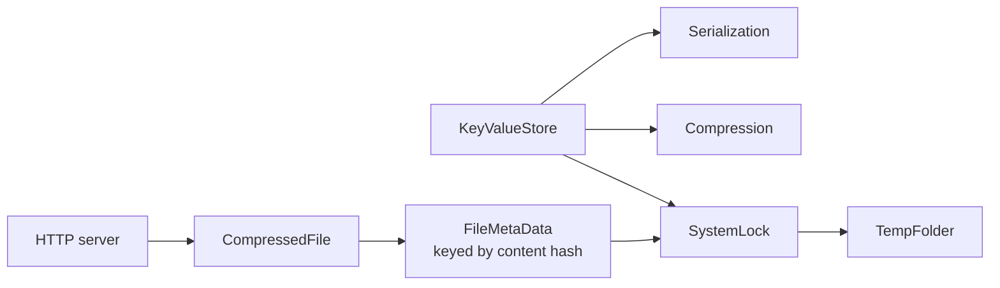

# SysWeaver.Storage

[⬆ SysWeaver overview](../README.md)

> Local persistence primitives: a redundant file-based key/value store, cached compressed copies of files, file meta-data databases, temporary cache folders and machine-wide locks.

| | |
|---|---|
| **Layer** | Storage / Data |
| **Kind** | Library |

## Purpose

Most services need a little durable state (settings, caches, small records) without running a database. This project provides it on top of the file system, using the framework's serializers and compressors, with redundancy and checksums so a single corrupted file does not lose data, and with file based locks so several processes can share the same data safely.

## How it fits into SysWeaver



The HTTP server serves pre-compressed static files through `CompressedFile`, authentication keeps settings in a `KeyValueStore`, and [SysWeaver.Storage.Cdc](../SysWeaver.Storage.Cdc/README.md) builds chunked storage on top of this project.

## Key features

- **Key/value store**: values are serialized (json by default), compressed (Brotli by default), suffixed with a SHA256 checksum and written as several redundant copies (default 3, at least 2), optionally spread over several volumes; reads return the most recent valid copy and corrupt copies are deleted. Sync and async APIs
- Four ready-made stores (`AllApp`, `UserApp`, `AllShared`, `UserShared`: per user or all users, per application or shared) plus custom stores created with `KeyValueStore.Get(KeyValueStoreParams)` and cached by id
- **Compressed file cache**: a compressed version of a file is created once and cached on disc, keyed by the file's content hash, compression type and level
- **File meta data**: derived data (gzip compressed json) and derived files associated with a file's content hash, rebuilt when the content changes and pruned when unused
- A cached hash of the *decompressed* content of a compressed file, and a stream that concatenates decompressed chunks
- **Embedded resources**: `Type.GetManifestResourceStream/Data/Text/Object` extensions that transparently decompress resources stored compressed (ex: `MyText.txt.br`)
- **Machine-wide named locks** based on exclusively opened lock files, working on every OS
- **Temp folders**: named cache folders (configurable, default under CommonApplicationData) whose old files are pruned at process exit

## Key components

- [`KeyValueStore`](KeyValueStore.cs) — redundant, checksummed, compressed file based key/value store
- [`SystemLock`](SystemLock.cs) — cross-process named locks
- [`FileMetaData`](FileMetaData.cs) — meta data and derived files keyed by a file's content hash
- [`CompressedFile`](CompressedFile.cs) — cached compressed copies of files
- [`StorageTypeExt`](StorageObjectExt.cs) — reading (possibly compressed) embedded resources

## Using it

```csharp
await KeyValueStore.AllApp.SetAsync("last-sync", DateTime.UtcNow);
var last = await KeyValueStore.AllApp.TryGetAsync<DateTime>("last-sync");

using (SystemLock.Get("MyApp.Migration")) { /* one process at a time */ }

using var s = await CompressedFile.OpenAsync(path, CompManager.GetFromHttp("br"));
```

## Limitations and considerations

- Designed for small-to-medium values and moderate write rates; it is not a database (no queries, transactions or indexing). Every operation reads or writes all copies of a key, and redundancy multiplies disc usage.
- Keys are used as file names and must be valid file names (no path separators, `:` etc.); invalid keys throw an `ArgumentException`. Keys are never transformed, so callers building keys from arbitrary text must sanitize them (ex: `PathExt.SafeFilename`).
- The serializer and the compression method aren't stored with the data, so they must not change for an existing store. An unknown serializer or compression code makes `KeyValueStore.Get` throw.
- Before 2026-10-07 `UserApp`, `AllShared` and `UserShared` were the same instance as `AllApp`; they now have their own locations and read (and copy) a key they don't have from `AllApp`.
- **Security**: stores that aren't per user (`AllApp`, `AllShared`, custom stores with `PerUser = false`) use folders that grant all local users read and write access. Don't store secrets or security relevant settings in them (ex: the API keys that `SimpleAuthorizer` keeps in `AllApp`).
- Locks are not re-entrant (taking the same lock twice from one flow dead locks), rely on cooperative use of a shared lock folder and wait by polling (10 ms, no fairness). `FileMetaData` processing holds a lock per key type, key suffix and content hash, so processing the same key type and suffix from inside its own callback dead locks.
- Cleanup of caches and temp folders only happens at process exit.

## Relationships

- **Project:** [`SysWeaver.Storage.csproj`](SysWeaver.Storage.csproj)
- **Builds on:** [SysWeaver.Common](../SysWeaver.Common/README.md), [SysWeaver.Common.Linux](../Platform/SysWeaver.Common.Linux/README.md), [SysWeaver.Common.Windows](../Platform/SysWeaver.Common.Windows/README.md), [SysWeaver.Compression](../SysWeaver.Compression/README.md), [SysWeaver.Serialization](../SysWeaver.Serialization/README.md)
- **Used by:** [SysWeaver.AI.LlmTranslator](../SysWeaver.AI.LlmTranslator/README.md), [SysWeaver.Auth.Core](../SysWeaver.Auth.Core/README.md), [SysWeaver.FolderSync](../SysWeaver.FolderSync/README.md), [SysWeaver.Media](../SysWeaver.Media/README.md), [SysWeaver.MicroService.HttpServer](../SysWeaver.MicroService.HttpServer/README.md), [SysWeaver.Storage.Cdc](../SysWeaver.Storage.Cdc/README.md), [Compress](https://github.com/dosh1974/SysWeaver.Tools/blob/main/Compress/README.md) and [SvgOpt](https://github.com/dosh1974/SysWeaver.Tools/blob/main/SvgOpt/README.md) (SysWeaver.Tools)
