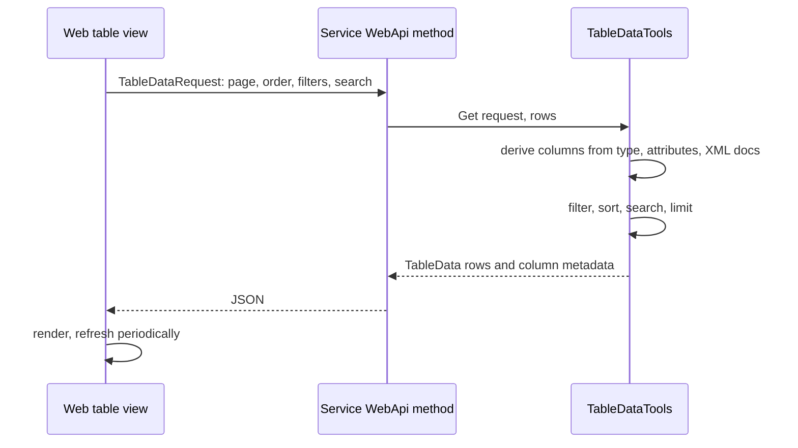

# SysWeaver.TableData

[⬆ SysWeaver overview](../README.md)

> The table engine behind every data grid in the SysWeaver web UI: turns any sequence of objects into paged, sorted, filtered, searchable, translatable and exportable table data, driven by attributes on the row type.

| | |
|---|---|
| **Layer** | Storage / Data |
| **Kind** | Library |

## Purpose

A service should expose tabular information by returning a collection — not by building a UI. `TableDataTools` inspects the row type, applies the client's request (page, order, filters, search) and returns rows plus column metadata that the web UI renders generically, including formatting hints such as byte sizes, durations, links, images or flags.

The shared contracts (`TableData`, `TypedTableData<T>`, `TableDataRequest`, `TableDataColumn`, `TableDataFilter`, `ITableDataExporter` and the `TableData*` attributes) live in [SysWeaver.Common](../SysWeaver.Common/README.md) (namespace `SysWeaver.Data`); this project contains the engine that implements them.

## How it fits into SysWeaver



Menu entries created with `[WebMenuTable]` point the UI's generic table page at such an API. The service manager, the HTTP server, authentication and the fake e-mail / text message services use it for their tables.

## Key features

- Column definitions derived automatically from the row type's public fields and properties, `TableData*` attributes (name, title, order, hide, key, sort, search weight, format, expand) and XML documentation; per-type metadata and compiled (expression tree) code is built once and cached
- Per-column filters (`TableDataFilterOps`: compare, contains / starts / ends with, any / none of a list, in / outside a range), multi-column ordering, ranked free-text search, paging with look-ahead and a server side row cap (`TableDataTools.DefaultMaxAllowedRows`, 100000)
- A column change counter (`Cc`) so column definitions are only sent when the client doesn't already have them; refresh rate hints
- Typed tables (`GetTyped`) as well as boxed rows (`Get`), and static tables from in-memory data or untyped `object[]` rows (`GetStaticTableFn`)
- Translation of `[AutoTranslate]` columns through an `ITranslator` (`TableDataTools.Translate`, `TypeTranslator`)
- Exporters: `CsvTableDataExporter` (comma, tab, semicolon), `HtmlTableDataExporter.Simple` and `MarkDownTableDataExporter`; JSON and Excel exporters live in other projects
- Data references (`DataReferenceStorage`, `TableDataReference`, `DataScopes`): server-side stored tables with a scope (global, signed-in users, session) and a sliding expiry, viewed, exported or edited through a reference id
- Table editing (`TableDataEdit`, `TableDataOp`, `EditTableDataRequest`): select / remove columns, append tables, merge columns, add computed columns from expressions (`NewTableDataColumn`), filter / sort / limit; exposed to the web UI and AI tools by the HTTP server

## Key components

- [`TableDataTools`](TableDataTools.cs) — the main entry point: request processing, static tables, translation, column helpers
- [`TableDataEdit`](Edit/TableDataEdit.cs) — table editing operations
- [`DataReferenceStorage`](DataReferenceStorage.cs) — scoped, expiring server side table storage
- [`CsvTableDataExporter`](CsvTableDataExporter.cs) — CSV export
- [`TypeTranslator`](Translation/TypeTranslator.cs) — translation of `[AutoTranslate]` members

## Using it

```csharp
public sealed class OrderRow { public long Id; public string Customer; public TimeSpan Age; }

[WebApi]
[WebApiAuth(Roles.Ops)]
[WebMenuTable(null, "Orders/{0}", "Orders", null, "IconTableServices")]
public TableData OrdersTable(TableDataRequest r) => TableDataTools.Get(r, 5000, Rows); // 5000 = refresh rate in ms
```

## Limitations and considerations

- Processing happens in memory over the supplied sequence; for very large datasets filter at the source first. Processing exceptions in `Get` / `GetTyped` are swallowed (an empty table is returned).
- Only supported primitive types (numbers, `bool`, `string`, date and time types except `DateTimeOffset`, `Guid`, `Type`, `Exception`, `object`), enums and their nullables become columns; other members are skipped unless marked with `[TableDataExpand]`.
- Enums (and other types without `IComparable<T>`) are sorted and compared by their text, not their number.
- `ExtractGet` and server side `TableDataEdit` operations apply no row cap by default; pass a limit when the result goes to a client.
- The per-user data scope (`DataScopes.User`) is declared but not supported yet, and column aggregation (`TableDataEdit.Aggregate`) is not implemented (throws `NotImplementedException`). Anyone who knows a global or any-user scoped data reference id can access that data.
- Computed columns only support numeric column types.
- CSV export doesn't protect values against spreadsheet formula injection.

## Relationships

- **Project:** [`SysWeaver.TableData.csproj`](SysWeaver.TableData.csproj)
- **Builds on:** [SysWeaver.Common](../SysWeaver.Common/README.md), [SysWeaver.Compression](../SysWeaver.Compression/README.md), [SysWeaver.Docs](../SysWeaver.Docs/README.md), [SysWeaver.ExpressionEvaluator](../SysWeaver.ExpressionEvaluator/README.md), [SysWeaver.Serialization](../SysWeaver.Serialization/README.md)
- **Used by:** [SysWeaver.Auth.Core](../SysWeaver.Auth.Core/README.md), [SysWeaver.DbSimpleStack](../SysWeaver.DbSimpleStack/README.md), [SysWeaver.Email.Fake](../Communication/SysWeaver.Email.Fake/README.md), [SysWeaver.EmailReader.Imap](../Communication/SysWeaver.EmailReader.Imap/README.md), [SysWeaver.EmailReader.Pop3](../Communication/SysWeaver.EmailReader.Pop3/README.md), [SysWeaver.HttpServer](../SysWeaver.HttpServer/README.md), [SysWeaver.MicroServices.ServiceManager](../SysWeaver.MicroServices.ServiceManager/README.md), [SysWeaver.TextMessage.AmazonEndUserMessaging](../Communication/SysWeaver.TextMessage.AmazonEndUserMessaging/README.md), [SysWeaver.TextMessage.Fake](../Communication/SysWeaver.TextMessage.Fake/README.md), [SysWeaver.TextMessage.Twilio](../Communication/SysWeaver.TextMessage.Twilio/README.md), [SysWeaver.TextMessage.WhatsApp](../Communication/SysWeaver.TextMessage.WhatsApp/README.md)
