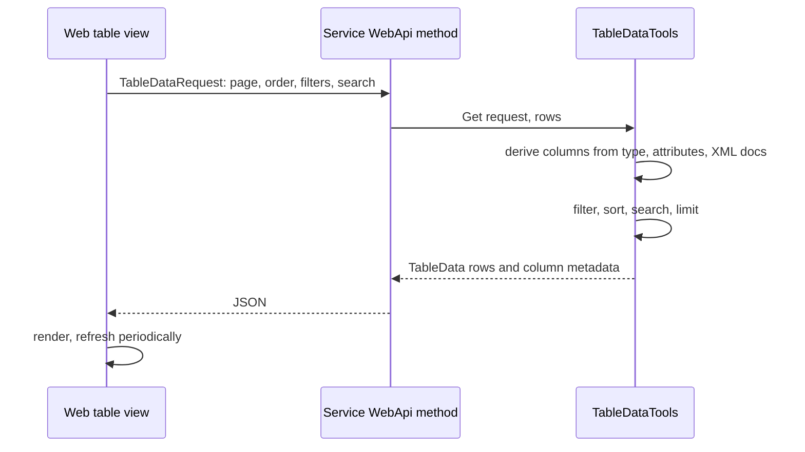

# SysWeaver.TableData

[⬆ SysWeaver overview](../README.md)

> The table engine behind every data grid in the SysWeaver web UI: turns any sequence of objects into paged, sorted, filtered, searchable, translatable and exportable table data, driven by attributes on the row type.

| | |
|---|---|
| **Layer** | Data |
| **Kind** | Library |

## Purpose

A service should expose tabular information by returning a collection — not by building a UI. `TableDataTools` inspects the row type, applies the client's request (page, order, filters, search) and returns rows plus column metadata that the web UI renders generically, including formatting hints such as byte sizes, durations, links, images or flags.

The shared contracts (`TableData`, `TypedTableData<T>`, `TableDataRequest`, `TableDataColumn`, `TableDataFilter`, `ITableDataExporter` and the `TableData*` attributes) live in [SysWeaver.Common](../SysWeaver.Common/README.md) (namespace `SysWeaver.Data`); this project contains the engine that implements them.

## How it fits into SysWeaver



Menu entries created with `[WebMenuTable]` point the UI's generic table page at such an API. The service manager uses this for its own diagnostic tables.

## Key features

- Column definitions derived automatically from the row type's public fields and properties, `TableData*` attributes (name, title, order, hide, key, sort, search weight, format, expand) and XML documentation. Per-type metadata and compiled (expression tree) code for extraction, sorting and filtering is built once and cached.
- Per-column filters (`TableDataFilterOps`: equals/compare, contains/starts/ends with, any/none of a comma separated list, in/outside a range; optionally case sensitive or inverted), multi-column ordering, ranked free-text search, paging with look-ahead and row limits.
- A column change counter (`Cc`, unique per server process) so column definitions and title are only sent when the client doesn't already have them; refresh rate hints.
- Translation of `[AutoTranslate]` columns through an `ITranslator` (`TableDataTools.Translate`, `TypeTranslator`); struct members, struct array elements and struct table rows are written back after translation, use `TypeTranslator.TranslateValue` / `TranslateBoxed` for a struct root value (a struct passed by value to `TypeTranslator.Translate` is translated in a copy).
- Typed tables (`GetTyped`, rows are the objects themselves) as well as boxed rows (`Get`).
- Static tables from in-memory data or from untyped `object[]` rows with explicit column definitions (`GetStaticTableFn`, using dynamically emitted row types).
- Exporters: `CsvTableDataExporter` (comma, tab, semicolon), `HtmlTableDataExporter.Simple` and `MarkDownTableDataExporter`; JSON and Excel exporters live in other projects.
- Data references (`DataReferenceStorage`, `TableDataReference`, `DataScopes`): server-side stored tables with scope (global, signed-in users, session) and a sliding expiry, which can be viewed, exported or edited through a reference id.
- Table editing (`TableDataEdit`, `TableDataOp`, `EditTableDataRequest`): select/remove columns, append tables, merge columns from two tables, add computed columns from expressions (`NewTableDataColumn`), filter/sort/limit; exposed to the web UI and AI tools by the HTTP server.

## Limitations and considerations

- Processing happens in memory over the supplied sequence; for very large datasets filter at the source first.
- `TableDataTools.Get` / `GetTyped` (and `TableDataType<T>.Get` / `GetTyped`) cap the requested row count server side: a request with no limit (`MaxRowCount` zero or negative) or above the cap gets at most `maxAllowedRows` rows (optional parameter, default `TableDataTools.DefaultMaxAllowedRows` = 100000; rows + look ahead never exceed it; zero or negative disables the cap for trusted server side callers). `ExtractGet` applies no cap, callers must cap client values themselves. Processing exceptions are swallowed (returning an empty table).
- Only supported primitive types (numbers, `bool`, `string`, `DateTime`, `DateOnly`, `TimeOnly`, `TimeSpan`, `Guid`, `Type`, `Exception`, `object`), enums and their nullables become columns (`DateTimeOffset` is not supported); other members are skipped unless marked with `[TableDataExpand]`. `Type` values are exported as the full name, `Exception` values as the message and `object` values as is when primitive or supported, else as their `ToString()` text.
- A `TableDataRequest.Row` (start row) above `int.MaxValue` is handled by enumerating (tabledata-cov-2), the row count of a page beyond the end is the start row.
- The per-user data scope (`DataScopes.User`) is declared but not supported yet. Data reference ids are random (unguessable), but anyone who knows a global or any-user scoped id can access that data.
- Column aggregation (`TableDataEdit.Aggregate`) is not implemented yet (throws `NotImplementedException`).
- Filter semantics: compare ops (`Equals` .. `GreaterEqual`) parse the filter value strictly (floating point numbers with the invariant culture, other numbers and dates with the current culture); an unparsable value makes `Filter` / `SortAndFilter` throw a `FormatException` and `Get` return an empty table. `Contains` / `StartsWith` / `EndsWith` work on the `ToString()` text. `AnyOf` / `NoneOf` / `InRange` / `OutsideRange` split the value on ',' and convert leniently (invalid entries become 0 / default); `InRange` is [min, max), `OutsideRange` is below min or above max (a value equal to max matches neither). Strings compare ordinal (case insensitive unless `CaseSensitive`), a null string is less than any string.
- Enum and nullable enum columns (and other types without `IComparable<T>`, or with `[TableDataNoSort]`) are sorted and compared by their text (the enum name, not the number).
- Nullable value type columns (ex: `int?`, `double?`, `DateTime?`) are sorted and compared by value with null first / less than any value (as `OrderBy` on the nullable type); an empty compare filter value (or `AnyOf` / range entry) is null, an invalid `AnyOf` / range entry is null too. `StringConverter` (`ToNullableXxx`, `GetMethod`), `StringConverterExp` and `StringToObject` support the nullable types.
- Text search ranks the rows over the public string members that aren't `[TableDataIgnore]` (the string columns of the row type, hidden ones included, not members of expanded members) plus any string member with a `[TableDataSearch]` attribute (even non-public or ignored ones, to search texts that aren't sent), never compiler generated backing fields and each member once, ordered by descending `[TableDataSearch]` weight; the rank of a match in a member is multiplied by its weight (default 1) times 0.95 per preceding searched member (tabledata-cov-15), and the result is ordered by rank.
- `TableDataEdit.Filter` (and the `SortAndFilterRows` step of `ApplyOps`) is a server side operation and is not capped by default (a `MaxRowCount` of zero or less keeps all rows, tabledata-cov-16), pass `maxAllowedRows` when the result goes to a client; `GetStaticTableFn` takes an optional `maxAllowedRows` (default `DefaultMaxAllowedRows`, so client requests stay capped).
- Data references returned to clients are capped: `TableDataReference.GetForClient` (used by the HTTP server's `GetTableData` web API / AI tool) throws an `InvalidOperationException` for a table with more than `DefaultMaxAllowedRows` rows (never truncated silently, the message tells to select a range with `EditTableData` first); the explore module's `DataRefTable` returns at most `DefaultMaxAllowedRows` rows.
- Computed columns (`AddColumns`) only support numeric column types; the values are converted to the column type (an overflow throws). Only the columns referenced by the expression are variables, so other columns may have any name (tabledata-cov-5); a function call (ex: `Max(A, B)`) is always the function, a referenced column named like an evaluator constant (ex: `E`, `PI`) is ambiguous and throws an `ArgumentException`. A constant expression (ex: `1 + 2`) gives its value on every row (tabledata-cov-18).
- A dynamic `[AutoTranslateContext]` on a table column keeps one format argument per member name: columns are read from the row, static members directly, other members (non column instance members) are formatted as an empty text (tabledata-cov-17).
- CSV export writes floating point / decimal values (also in nullable columns) with the invariant culture and other values (ex: dates) with the current culture; values are not protected against spreadsheet formula injection.

## Using it

```csharp
public sealed class OrderRow { public long Id; public string Customer; public TimeSpan Age; }

[WebApi]
[WebApiAuth(Roles.Ops)]
[WebMenuTable(null, "Orders/{0}", "Orders", null, "IconTableServices")]
public TableData OrdersTable(TableDataRequest r) => TableDataTools.Get(r, 5000, Rows); // 5000 = refresh rate in ms
```

## Relationships

- **Project:** [`SysWeaver.TableData.csproj`](SysWeaver.TableData.csproj)
- **Builds on:** [SysWeaver.Common](../SysWeaver.Common/README.md), [SysWeaver.Compression](../SysWeaver.Compression/README.md), [SysWeaver.Docs](../SysWeaver.Docs/README.md), [SysWeaver.ExpressionEvaluator](../SysWeaver.ExpressionEvaluator/README.md), [SysWeaver.Serialization](../SysWeaver.Serialization/README.md)
- **Used by:** [SysWeaver.Auth.Core](../SysWeaver.Auth.Core/README.md), [SysWeaver.DbSimpleStack](../SysWeaver.DbSimpleStack/README.md), [SysWeaver.HttpServer](../SysWeaver.HttpServer/README.md), [SysWeaver.MicroServices.ServiceManager](../SysWeaver.MicroServices.ServiceManager/README.md), [SysWeaver.TextMessage.Fake](../Communication/SysWeaver.TextMessage.Fake/README.md)
