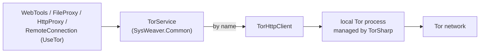

# SysWeaver.Tor

[⬆ SysWeaver overview](../README.md)

> An `HttpClient` that routes requests through the Tor network.

| | |
|---|---|
| **Layer** | Networking |
| **Kind** | Library (optional plug-in, located at runtime) |

## Purpose

Allow services to fetch remote content anonymously or from networks that block direct access. Nothing references this assembly at compile time: `TorService` in [SysWeaver.Common](../SysWeaver.Common/README.md) looks for `SysWeaver.Tor.TorHttpClient, SysWeaver.Tor` by name, and when it is deployed, `UseTor` options light up in `WebTools`, the HTTP server's `FileProxy` and `HttpProxy`, [remote API connections](../SysWeaver.Remote.Connection/README.md) and the Google translator.

## How it fits into SysWeaver



## Key features

- On first use downloads (if needed) and starts a local Tor process through TorSharp (Privoxy disabled), stopped when the process exits
- `TorHttpClient.Create(autoDecompress)` returns an `HttpClient` using the local SOCKS5 proxy (automatic decompression of all methods by default)
- `TorHttpClient.Proxy` exposes the SOCKS5 `WebProxy` for code that builds its own handler

## Key components

- [`TorHttpClient`](TorHttpClient.cs) — Tor start-up, the SOCKS5 proxy and the client factory

## Using it

Deploy the assembly with the application, then set `UseTor` on the component (ex: `"UseTor": true` in the `Params` of a remote API connection), or use the client from code without a compile time reference:

```csharp
if (TorService.IsAvailable)
{
    using var client = TorService.CreateTorClient(true);   // true = decompress responses automatically
    var html = await client.GetStringAsync("https://example.com/");
}
```

## Limitations and considerations

- Tor adds substantial latency and variable throughput.
- The Tor tooling is downloaded and started in the background on first use, which requires network access and suitable permissions; requests issued before Tor is ready can fail, and start-up errors are not reported to the caller.
- Must be deployed next to the application (or referenced) for `TorService.IsAvailable` to be true.

## Relationships

- **Project:** [`SysWeaver.Tor.csproj`](SysWeaver.Tor.csproj)
- **Builds on:** [SysWeaver.Common](../SysWeaver.Common/README.md)
- **Used by:** service [TranslationService](https://github.com/dosh1974/SysWeaver.Services/blob/main/TranslationService/README.md); tool [SwCurl](https://github.com/dosh1974/SysWeaver.Tools/blob/main/SwCurl/README.md)
- **Third-party:** `Knapcode.TorSharp`, `SharpCompress`
