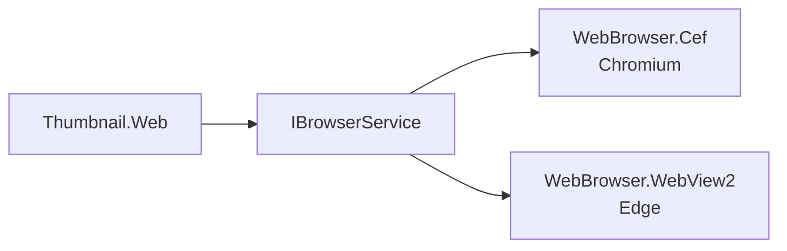

# SysWeaver.WebBrowser

[⬆ SysWeaver overview](../README.md)

> Contracts for headless browser services, so browser automation features do not depend on a particular engine.

| | |
|---|---|
| **Layer** | Media |
| **Kind** | Library (contracts) |

## Purpose

Rendering web pages to images (thumbnails, screenshots) needs a browser engine. This project defines the minimal contract consumers program against, so the engine can be swapped by changing the manifest.

## How it fits into SysWeaver

The engine is chosen by which implementation is listed in the manifest.

## Key features

- Open off-screen browser windows (`IBrowserService.OpenWindow`)
- Per window: resize (with scale), load a URL and wait for it, run JavaScript, expose .NET objects to JavaScript, capture PNG or JPEG

## Key components

- [`IBrowserService`](IBrowserService.cs) — the browser service contract
- [`IBrowserWindow`](IBrowserWindow.cs) — an open browser window
- [`BrowserJsResponse`](BrowserJsResponse.cs) — result of running JavaScript

## Relationships

- **Project:** [`SysWeaver.WebBrowser.csproj`](SysWeaver.WebBrowser.csproj)
- **Builds on:** —
- **Used by:** [SysWeaver.MicroService.Thumbnail.Web](../SysWeaver.MicroService.Thumbnail.Web/README.md), [SysWeaver.WebBrowser.Cef](../Internet/SysWeaver.WebBrowser.Cef/README.md), [SysWeaver.WebBrowser.WebView2](../Internet/SysWeaver.WebBrowser.WebView2/README.md)
